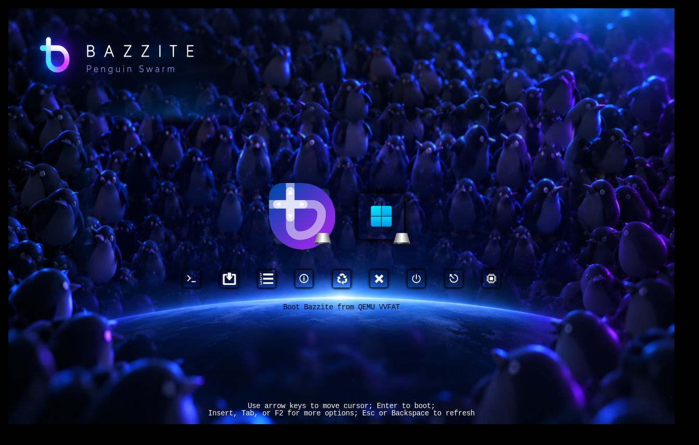

# rEFInd Bazzite Penguin Swarm

An experimental, 4K Bazzite rEFInd theme inspired by the approved **Penguin Swarm** concept: dozens of penguins under blue-violet neon lighting, a glowing horizon, and an alternative Shadow-rEFInd icon set with dark square OS icons and matched selection tiles. It is an alternate design to [`rEFInd-bazzite-pneaple`](https://github.com/zany130/rEFInd-bazzite-pneaple), not a replacement for rEFInd or its boot configuration.

> **Status: visual installation candidate (Shadow-rEFInd icon revision).** PNG dimensions, paths, and archive integrity are validated; it has **not been boot-tested** on actual firmware. Preview images are illustrations, **not screenshots of rEFInd**.



## What is included

- `background.png`: 3840×2160 RGB clean composited penguin background with **no frozen menu icons, glass cards or boot labels**.
- `icons/os_bazzite.png`: retained custom 576×576 Bazzite glass-card art, rendered at 128px because upstream Shadow-rEFInd has no `os_bazzite.png`. `icons/os_win.png`, `os_win11.png`, `os_windows.png`: original Shadow-rEFInd Windows PNGs (128×128), with aliases of the same source image.
- `icons/os_shell.png` / `os_rescue.png`: retained custom 576×576 icons, scaled by rEFInd to 128px for optional manual OS entries. These **do not create a working boot menu entry by themselves**.
- `icons/func_firmware.png`, `func_reset.png`, `func_shutdown.png`, `tool_shell.png` and `tool_rescue.png`: original 48×48 Shadow-rEFInd utility images.
- `selection_big.png`: matching **144×144 Shadow-rEFInd** selection graphic for 128px OS icons.
- `selection_small.png`: matching **64×64 Shadow-rEFInd** selection graphic for 48px utility icons.
- `screenshots/`: original approved mockup and an **old glass-card artwork** composite preview; **neither screenshot depicts the Shadow icon variant**.
- `source/`: approved source files and reconstructed lower-res background; not needed on your EFI partition. `third_party/Shadow-rEFInd-AGPL-3.0.txt` contains the complete upstream icon license.

## Shadow-rEFInd icon update (draft)

This revision imports **actual unmodified Shadow-rEFInd PNGs** (not AI-rendered copies) for Windows, firmware, reboot, shutdown, Shell and Rescue tools, and both **matching white selection graphics**. It leaves the 3840×2160 penguin-swarm wallpaper untouched.

Shadow-rEFInd has **no Bazzite-specific icon**. Rather than displaying an incorrect distro logo, the earlier custom Bazzite glass-card image is retained. The earlier custom Shell and Rescue images are also retained for optional main-row entries; the new Shadow versions are `tool_shell.png` and `tool_rescue.png` for the utility row.

The old mockup and composite screenshot remain **historical design previews**, not visualizations of this updated icon set. Because Shadow-rEFInd's native OS icons are 128px and utility icons 48px, the row will be much smaller than the original 576px glass-card concept. This is deliberate for a faithful first hardware test and can be revisited after a true firmware screenshot.

Upstream: https://github.com/chris1111/Shadow-rEFInd
Pinned upstream commit: `fe639d2869f59d291489c0c416c17577bd166046`
Full upstream AGPL-3.0 license: `third_party/Shadow-rEFInd-AGPL-3.0.txt`

**License caution:** The existing project's MIT license is not a blanket license for imported AGPL-3.0 images. Consult the included full AGPL text and attribution when redistributing, especially if making altered composite assets. The original penguin image's redistributability still needs confirmation.

## Installation (existing working rEFInd installation only)

**Do not replace `refind.conf` with an upstream theme config or touch any `.efi` bootloader binaries.**

The install ZIP unpacks to a folder named `rEFInd-bazzite-penguin-swarm`. On the Bazzite machine, first back up your existing config **off the EFI partition**:

```sh
cp /boot/efi/EFI/refind/refind.conf "$HOME/refind.conf.before-penguin-swarm.bak"
```

Then, in the directory containing the extracted theme folder:

```sh
sudo cp -a rEFInd-bazzite-penguin-swarm /boot/efi/EFI/refind/themes/
```

Edit only the last `include themes/.../theme.conf` in `/boot/efi/EFI/refind/refind.conf` to:

```conf
include themes/rEFInd-bazzite-penguin-swarm/theme.conf
```

Keep all your existing menu stanzas, `volume`, loader paths, `scanfor`, and `default_selection` settings unchanged. If your working manual Bazzite entry doesn't already specify a Bazzite icon, add just this line within its existing stanza:

```conf
icon /EFI/refind/themes/rEFInd-bazzite-penguin-swarm/icons/os_bazzite.png
```

In particular, keep your **working Secure Boot chain through `/EFI/fedora/shimx64.efi`**. Never point the Bazzite boot stanza at GRUB directly in this configuration.

### System utility icons

If desired, `showtools firmware,reboot,shutdown` belongs in the *main* `refind.conf` so changing themes never alters which tools are enabled. The EFI Shell normally appears as a **utility** (if enabled); adding an `os_shell.png` does not move it into the OS row. An OS-row Shell icon requires a manually defined entry with a trusted shell EFI loader; `os_rescue.png` similarly needs a real boot target.

### Limitations / what differs from the mockup

- rEFInd shows only the currently selected OS entry's label by default; the mockup shows several simultaneously. The old glass-card artwork remains only for the Bazzite and custom optional main-row icons; the remaining imported icons use Shadow-rEFInd's dark-gray visual style.
- Boot icon coordinates cannot be arbitrarily fixed to the mockup. Depending on how many entries are discovered, card sizes, menu locations, and tool alignment may differ at runtime.
- **Shadow-rEFInd is a compact, native-size 128px/48px icon set.** This revision uses `big_icon_size 128` and `small_icon_size 48` with matching upstream selections. The icons may look relatively small at 3840×2160. Test the actual firmware output before adjusting sizes, since scaling the PNGs up can soften them.
- The wallpaper is reconstructed from the user's provided original penguin artwork and AI concept screenshot, not the source of the original photographed penguins. Background is resampled from 1672×941 to 4K, not natively 4K-rendered.

## Revert

Restore the previous include line (and previous Bazzite manual icon path if changed) or restore the saved config backup. Leave the previous theme installed until you verify this one boots and looks correct. No EFI binaries or NVRAM entries are changed by this theme package.

## Building from source

Requires Python 3, Pillow and NumPy. Run `python3 scripts/build_assets.py` from anywhere to rebuild the penguin background only. It deliberately **does not overwrite imported Shadow-rEFInd icon or selection PNGs**, or the visual-only `theme.conf`. Use `python3 scripts/sync_shadow_icons.py` to reproduce the original icons from the pinned upstream revision using Git SHA verification. `source/` is intentionally omitted from the compact install ZIP.

## Source artwork: "100K Penguins!"

The original penguin-swarm image supplied for this theme is attributed to the **[100K Penguins! announcement](https://universal-blue.discourse.group/t/100k-penguins/12577)** on the official Universal Blue community forum. The announcement was posted by **kylegospo on October 13, 2026**, celebrating 100,000 weekly active users of Universal Blue. That identifies the *publisher and occasion*, **not necessarily the original illustrator or full copyright owner**.

This theme's `source/user-supplied-penguin-swarm.png` is the original image supplied for our redesign. The published `background.png` is a **modified, tinted, resampled and re-composited derivative** featuring the user's approved glowing planetary horizon. The accompanying concept screenshots are illustrations rather than photographs or real firmware captures.

**Permission status:** The announcement identifies a credible official source, but does **not explicitly specify a reuse/derivative license** for the penguin illustration. Even though the image appeared in an official project announcement, that alone does not establish permission to redistribute edited copies under the theme's MIT license. Confirm copyright ownership and derivative/redistribution permission with the Bazzite/Universal Blue team or image rights holder before treating the wallpaper as freely reusable. A source credit is useful but is **not a substitute for a license or permission**.

This is an **unofficial fan/community rEFInd theme**; it is not affiliated with, sponsored by, or endorsed by Bazzite or Universal Blue. Logos and other trademarks remain the property of their respective owners.

## Authorship, sources, and licensing

Original layout inspired by Lumen's glass-card aesthetic ([Shoxjaxon Atabayev](https://github.com/shoxjaxon-atabayev/rEFInd-lumen), MIT); the Shadow-rEFInd variant redistributes original icon files from [chris1111/Shadow-rEFInd](https://github.com/chris1111/Shadow-rEFInd), which is licensed under **AGPL-3.0**. Icon shadows take inspiration from BsxM1 by AlexFullmoon. The source penguin image was supplied by the user; **its redistribution license is not verified**. The published repo currently contains that image and a derived background, which still need a provenance/licensing review independent of this icon PR. The project's existing MIT licensing does **not** cover imported Shadow-rEFInd artwork; see `third_party/Shadow-rEFInd-AGPL-3.0.txt`. Preserve the AGPL-3.0 obligations and notices when redistributing. This repo's separately originated scripts and layout remain identified as such. See `ATTRIBUTION.md` and `LICENSE`.

This theme is not affiliated with or endorsed by Bazzite, Universal Blue, Microsoft, or the creators of other rEFInd themes.
