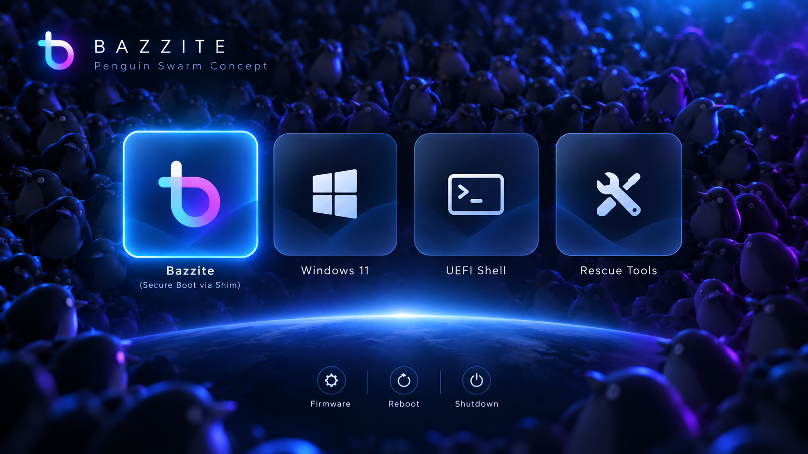

# rEFInd Bazzite Penguin Swarm

An experimental, 4K Bazzite rEFInd theme inspired by the approved **Penguin Swarm** concept: dozens of penguins under blue-violet neon lighting, a glowing horizon, and four frosted blue glass-card icons. It is an alternate design to [`rEFInd-bazzite-pneaple`](https://github.com/zany130/rEFInd-bazzite-pneaple), not a replacement for rEFInd or its boot configuration.

> **Status: visual installation candidate.** PNG dimensions, paths, and archive integrity are validated; it has **not been boot-tested** on actual firmware. Preview images are illustrations, **not screenshots of rEFInd**.



## What is included

- `background.png`: 3840×2160 RGB clean composited penguin background with **no frozen menu icons, glass cards or boot labels**.
- `icons/os_bazzite.png`, `os_win.png`, `os_win11.png`, `os_windows.png`: 576×576 RGBA transparent glass-card icons for Bazzite and Windows.
- `icons/os_shell.png` / `os_rescue.png`: optional 576×576 icons. These **do not create a working boot menu entry by themselves**.
- `icons/func_firmware.png`, `func_reset.png`, `func_shutdown.png`: 96×96 utility buttons for built-in rEFInd functions.
- `selection_big.png`: 648×648 transparent blue outline/glow for the selected OS icon.
- `selection_small.png`: 128×128 transparent glow for selected utility buttons.
- `screenshots/`: original approved mockup and an illustrative composite preview.
- `source/`: approved source files and reconstructed lower-res background; not needed on your EFI partition.

## Installation (existing working rEFInd installation only)

**Do not replace `refind.conf` with an upstream theme config or touch any `.efi` bootloader binaries.**

The install ZIP unpacks to a folder named `rEFInd-bazzite-penguin-swarm`. On the Bazzite machine, first back up your existing config **off the EFI partition**:

```sh
cp /boot/efi/EFI/refind/refind.conf "$HOME/refind.conf.before-penguin-swarm.bak"
```

Then, in the directory containing the extracted theme folder:

```sh
sudo cp -a rEFInd-bazzite-penguin-swarm /boot/efi/EFI/refind/themes/
```

Edit only the last `include themes/.../theme.conf` in `/boot/efi/EFI/refind/refind.conf` to:

```conf
include themes/rEFInd-bazzite-penguin-swarm/theme.conf
```

Keep all your existing menu stanzas, `volume`, loader paths, `scanfor`, and `default_selection` settings unchanged. If your working manual Bazzite entry doesn't already specify a Bazzite icon, add just this line within its existing stanza:

```conf
icon /EFI/refind/themes/rEFInd-bazzite-penguin-swarm/icons/os_bazzite.png
```

In particular, keep your **working Secure Boot chain through `/EFI/fedora/shimx64.efi`**. Never point the Bazzite boot stanza at GRUB directly in this configuration.

### System utility icons

If desired, `showtools firmware,reboot,shutdown` belongs in the *main* `refind.conf` so changing themes never alters which tools are enabled. The EFI Shell normally appears as a **utility** (if enabled); adding an `os_shell.png` does not move it into the OS row. An OS-row Shell icon requires a manually defined entry with a trusted shell EFI loader; `os_rescue.png` similarly needs a real boot target.

### Limitations / what differs from the mockup

- rEFInd shows only the currently selected OS entry's label by default; the mockup shows several simultaneously. The glass-card art, however, is part of each transparent PNG and can be reproduced on real rEFInd menus.
- Boot icon coordinates cannot be arbitrarily fixed to the mockup. Depending on how many entries are discovered, card sizes, menu locations, and tool alignment may differ at runtime.
- Since icons are 576px wide and the selection glow adds 72px, **large numbers of detected boot entries may overflow the row**. Reduce `big_icon_size` to 448 or 384 and test if that happens (images will be scaled automatically).
- The wallpaper is reconstructed from the user's provided original penguin artwork and AI concept screenshot, not the source of the original photographed penguins. Background is resampled from 1672×941 to 4K, not natively 4K-rendered.

## Revert

Restore the previous include line (and previous Bazzite manual icon path if changed) or restore the saved config backup. Leave the previous theme installed until you verify this one boots and looks correct. No EFI binaries or NVRAM entries are changed by this theme package.

## Building from source

Requires Python 3, Pillow and NumPy. Run `python3 scripts/build_assets.py` from anywhere. It recreates the theme files from `source/` assets. `source/` is intentionally omitted from the compact install ZIP.

## Authorship, sources, and licensing

Inspired by Lumen's glass-card aesthetic ([Shoxjaxon Atabayev](https://github.com/shoxjaxon-atabayev/rEFInd-lumen), MIT); the layout and assets here are separately composed. Icon shadows take inspiration from BsxM1 by AlexFullmoon. The source penguin image was supplied by the user; **before public redistribution, confirm that its copyright owner permits redistribution and derivatives**. The README and Python build script are MIT-licensed; that license does not automatically apply to third-party imagery or OS trademarks. See `ATTRIBUTION.md` and `LICENSE`.

This theme is not affiliated with or endorsed by Bazzite, Universal Blue, Microsoft, or the creators of other rEFInd themes.
